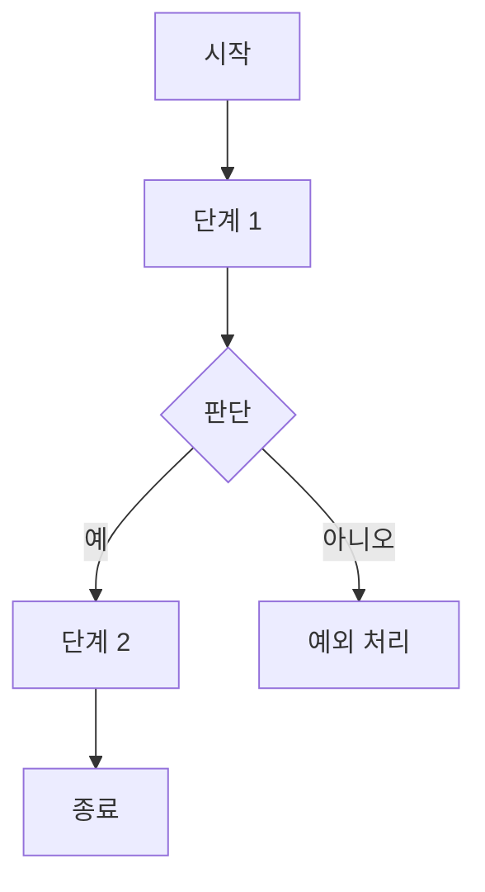

# {부서} - {업무명}

> 작성일: {YYYY-MM-DD} / 원본: `inbox/{부서}_{업무명}/` / 상태: 초안 (확인 필요 사항 {N}건)

## 1. 업무 개요
| 항목 | 내용 |
|---|---|
| 목적 | |
| 담당 부서·직무 | |
| 주기 | 일 / 주 / 월 / 수시 |
| 1회 소요시간 | |

## 2. 선행·후행 업무
| 구분 | 부서 | 업무 | 전달 내용(문서/데이터) |
|---|---|---|---|
| 선행 (받는 것) | | | |
| 후행 (넘기는 것) | | | |

## 3. 프로세스 흐름도

## 4. 단계별 절차
### 4-1. {단계명}

- **화면 설명**: (위치를 구체적으로. 예: 좌측 상단 [저장] 버튼)
- **입력 항목**:
  | 항목명 | 입력 방식(직접/선택/복사) | 예시 |
  |---|---|---|
- **판단 기준**:

## 5. 데이터 정의
### 입력 데이터
| 항목명 | 형식 | 출처(ERP 메뉴/엑셀 시트) | 필수 여부 |
|---|---|---|---|

### 출력 데이터
| 항목명 | 형식 | 출처/저장 위치 | 필수 여부 |
|---|---|---|---|

## 6. 업무 규칙·예외 처리
- **승인 기준**:
- **예외 케이스**:
  | 상황 | 처리 방법 | 담당 |
  |---|---|---|

## 7. 사용 시스템·양식
| 구분 | 내용 |
|---|---|
| ERP 메뉴 경로 | 이카운트 > |
| 엑셀 파일명 / 시트 | |
| 결재선 | |

## 8. 문제점·수작업 포인트
| 유형 | 내용 | 관련 단계 |
|---|---|---|
| 중복 입력 | | |
| 복사-붙여넣기 | | |
| 수기 계산 | | |
| 대기 시간 | | |

## 9. 그룹웨어(IAN) 개발 요구사항 제안
| 구분 | 제안 내용 | 근거(단계) |
|---|---|---|
| 화면 | | |
| 권한 | | |
| 알림 | | |
| 결재 | | |
| ERP 연동 | | |

## 10. 자동화·AI 적용 후보
| 대상 단계 | 방법(규칙 자동화/OCR/AI 요약·분류 등) | 기대효과 | 난이도(상/중/하) |
|---|---|---|---|

## 11. 확인 필요 사항
- [ ] (담당자) 
- [ ] (개발자) 
